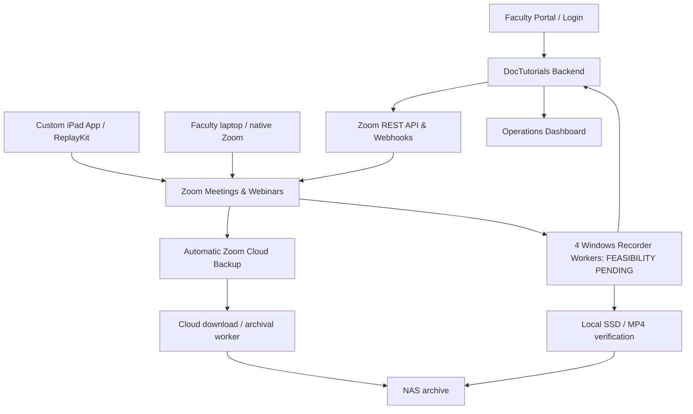

# DocTutorials Zoom Suite

**Status:** Architecture baseline v0.1; Gate 1 operator-reported implemented (evidence pending); Gate 2 S2S OAuth setup in progress (`DocTutorials-Backend` created per operator; Information + five read scopes + activation operator-confirmed; API test pending)  
**Updated:** 2026-11-13  
**Owner:** DocTutorials  
**Repository:** Private `vinodkumar-Hegde/doctutorials-zoom-suite`.

An integrated faculty teaching and recording platform built around four existing Zoom meeting/webinar host users, a custom DocTutorials iPad app, a faculty portal, and a Windows recording server.

## Product goals
1. Faculty authenticate to **DocTutorials**, not to the shared Zoom host accounts.
2. Faculty teach either (a) laptop webcam/audio + iPad screen share or (b) laptop-only webcam/audio/screen share.
3. Four separate Zoom host users may run four sessions concurrently, in different courses/subjects and with different webinar capacities.
4. **Zoom automatic cloud recording** provides a safety backup for all four host users.
5. **Windows office recording** produces independent local session files and transfers verified artifacts to NAS.
6. Operators see live session and recording health; failures are actionable, auditable, and recoverable.

## Project layout
- `docs/01-PRODUCT-REQUIREMENTS.md` — confirmed requirements and non-goals
- `docs/02-SYSTEM-ARCHITECTURE.md` — boundaries and component diagram
- `docs/03-ZOOM-ADMIN-SETUP.md` — cloud backup admin configuration
- `docs/04-ZOOM-DEVELOPER-APPS.md` — developer apps and permissions
- `docs/05-AUTH-ROLES-SECURITY.md` — identities, access, secrets
- `docs/06-RECORDING-FLOWS.md` — teaching and recording state flows
- `docs/07-IPAD-APP.md` — app experience and ReplayKit
- `docs/08-WINDOWS-RECORDER.md` — 4-channel recorder plan and feasibility gate
- `docs/09-DATA-MODEL-API.md` — initial entities and API ideas
- `docs/10-ROADMAP-ACCEPTANCE.md` — gates, milestones, tests
- `docs/11-RISKS-DECISIONS.md` — risks, assumptions, ADRs
- `docs/12-DEPLOYMENT-OPS.md` — deployment and operations
- `docs/13-OFFICIAL-REFERENCES.md` — official Zoom documentation
- `docs/SESSION-NOTES.md` — ongoing work log
- `docs/ZOOM-CONFIG-CHECKLIST.md` — actionable checkboxes
- `docs/14-REPOSITORY-PUBLISH.md` — one-time private GitHub setup and release steps
- `docs/15-MILESTONE-2-S2S-OAUTH-RUNBOOK.md` — OAuth app configuration checklist
- `docs/16-MILESTONE-2-SECURE-API-SMOKE.md` — PowerShell procedure and safe reporting
- `backend/zoom_s2s_smoke_test.py` — standard-library-only S2S read-only four-host API test
- `tests/test_zoom_s2s_smoke_test.py` — 13 offline unit tests
- `AGENTS.md` — development-agent standing instructions

## Architecture sketch

## Key caveats
- Enabling cloud recording at account level does not by itself configure existing scheduled webinars; audit them.
- Native Zoom **local** recording on the Windows machine is independent from Zoom cloud recording. Zoom webhooks are not a generic remote-local-record trigger.
- Four concurrent Zoom client workers on one physical Windows host are **not yet verified**, including VM audio/video, same-account session behavior, host identity, and SDK control.
- Faculty's iPad must confirm ReplayKit screen broadcasting; no silent start.
- The Zoom Meeting SDK is for interactive apps, **not unattended media-recording bots**. RTMS is an architectural fallback if local-native controls fail.

## How to start
Milestone 1 cloud recording settings are reported as implemented by the operator. Do not repeat changes to live account settings. Collect Gate 1 redacted evidence in parallel with Gate 2. Follow `docs/15-MILESTONE-2-S2S-OAUTH-RUNBOOK.md` to create the read-only `DocTutorials-Backend` app; operator-confirmed app creation, Information and scope setup reported complete; activation operator-confirmed; a safe four-host read-only smoke test is committed and nine offline tests pass; live tenant verification and secret-vault provisioning remain pending. See `docs/10-ROADMAP-ACCEPTANCE.md` and `docs/14-REPOSITORY-PUBLISH.md`.

**Do not commit passwords, SDK secrets, OAuth credentials, session join URLs, access tokens, ZAK tokens, recordings, learner personal data, or private faculty data.** Use a secret manager and `.env.example` for key names only.
## Live OAuth status and separate Basic sandbox mode (2026-11-14)

The first real S2S token grant and `GET /users` **passed**, but that app's organization returned only **one active user and zero eligible paid hosts**. The production four-host acceptance test **did not pass** and remains pending. The Windows operator subsequently confirmed **13/13 offline tests PASS**, plus a live free sandbox run with OAuth PASS, users GET PASS (1) and scheduled meetings GET PASS (0), with detail GET SKIPPED. The code supports `python backend\zoom_s2s_smoke_test.py --sandbox-single-user` for explicit one-user Basic meeting-read tests, without treating the result as four-host or webinar acceptance. To exercise meeting detail GET, schedule a harmless future meeting in the separate sandbox and rerun the one-user read-only test; production remains separate. See `docs/16-MILESTONE-2-SECURE-API-SMOKE.md` for safe instructions.
